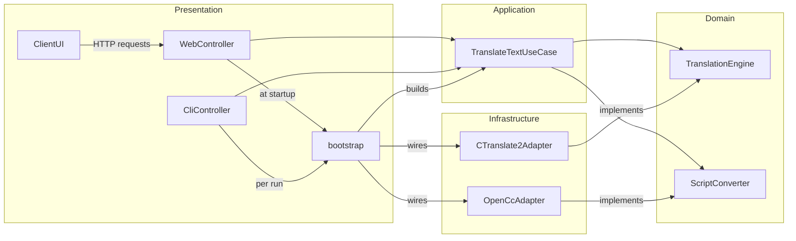
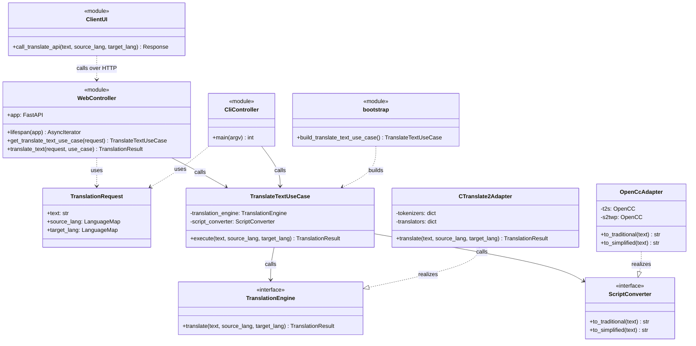
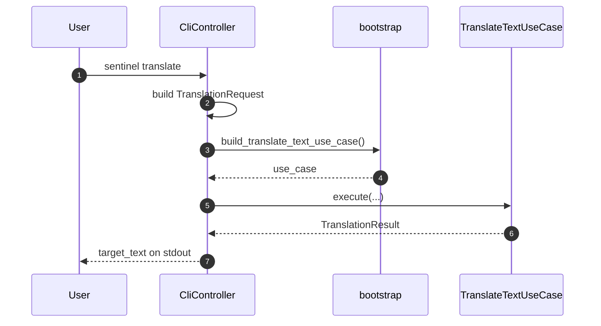
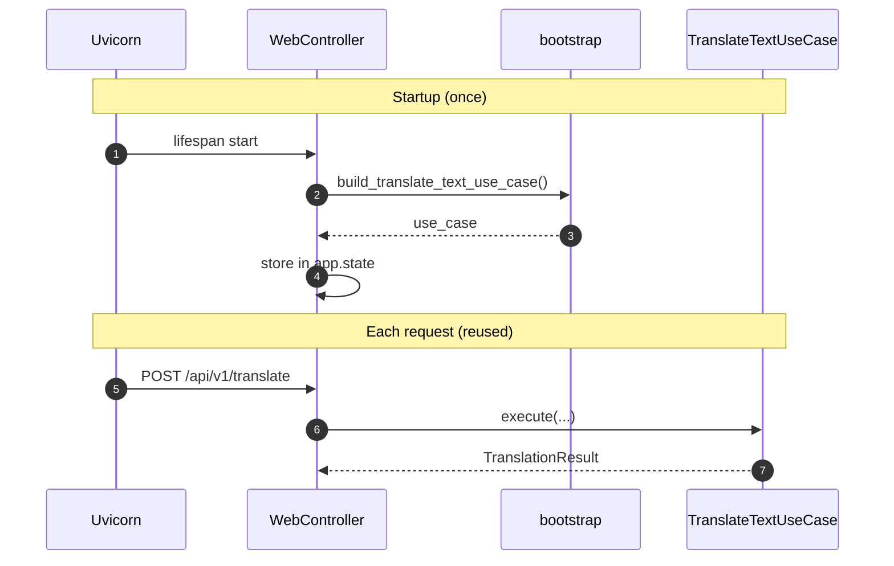
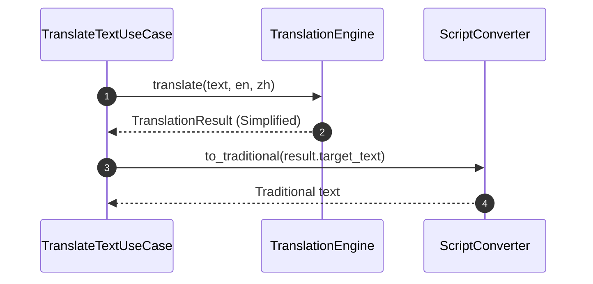
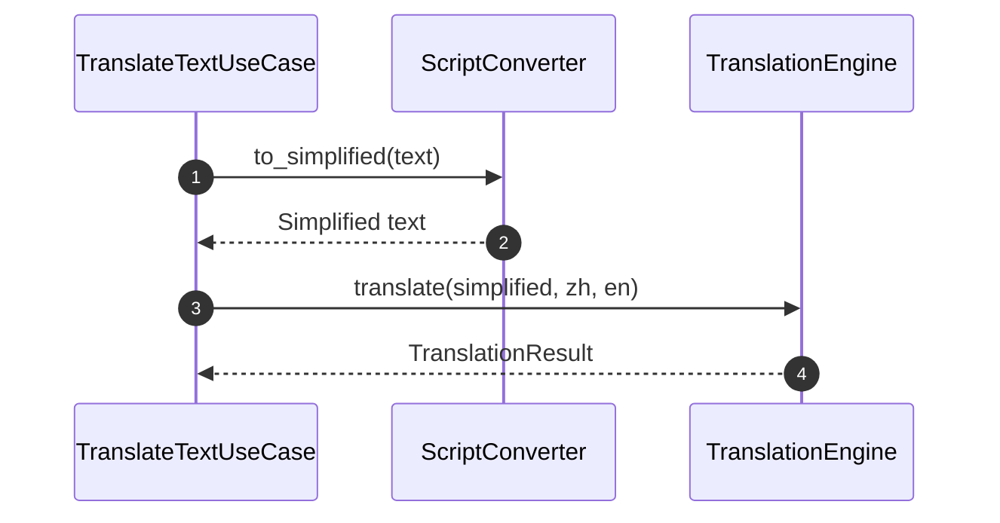
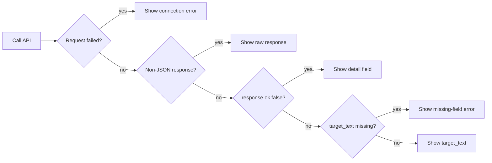

# Sentinel Rosetta

## 1. Project Description

Sentinel Rosetta 是專為實體隔離（Air-gapped）內網設計的英中雙向神經翻譯引擎：使用者手動指定翻譯方向並提交文字，取得可直接複製的譯文，專有名詞的譯名由微調後的模型權重提供（`ADR-0010`）。目標環境執行期間無對外連線（`ADR-0004`），沒有 GPU，神經機器翻譯（NMT）只以 CPU 推論。三個入口（Command-Line Interface (CLI)、HTTP Application Programming Interface (API) 與 Streamlit User Interface (UI)）共用同一個 use case。系統不做語言自動偵測，不在執行期處理詞彙表，不訓練模型（權重的微調由獨立的訓練程式負責，見 `DesignDocument_Finetune.md`）。核心設計約束：Domain 層僅保留業務邏輯與 interface，不耦合任何 Web 框架、機器學習套件或資料庫驅動；所有外部能力皆經由 Domain 所定義的 interface 反轉取得。設計決策記錄於 Architecture Decision Record (ADR)，見第 4 節。

## 2. Architecture

### 2.1 Component Diagram

實線箭頭代表呼叫或資料流向；`implements` 箭頭指向被實作的 interface，不代表資料流向。

- **依賴方向：** Domain 不 import 其他層；Application 只 import Domain；Infrastructure 至多 import Domain；`bootstrap.py` 組裝 Application 與 Infrastructure；`ClientUI` 不 import 專案內任何層，只經 HTTP 呼叫 `WebController`。
- **資源所有權：** `CTranslate2Adapter` 在建構時載入兩個方向的模型權重與 tokenizer 並持有，隨 `TranslateTextUseCase` 實例存活，隨 process 結束釋放；沒有跨 thread 或 process 的交接。

### 2.2 Types and Interfaces

## 3. Flow of Control

### 3.1 Flow: CLI Invocation

1. 圖中步驟 1 至 2：`CliController` 解析 argv 並建立 `TranslationRequest`。
2. 圖中步驟 3 至 4：`bootstrap` 每次執行建立一次 `TranslateTextUseCase`。CLI 的一次執行是一個 process，模型權重在建構時載入，隨 process 結束釋放。
3. 圖中步驟 5 至 7：呼叫 `execute()`，把 `target_text` 印到 stdout，exit code 為 0。

### 3.2 Flow: Service Startup and Request Handling

1. 圖中步驟 1 至 4：啟動時建立一次 `TranslateTextUseCase` 並存入 `app.state`；請求之間重用同一個實例，不重新載入模型權重。
2. 圖中步驟 5 至 7：之後每個請求經 FastAPI 的 `Depends` 取得同一個實例。

### 3.3 Flow: Translate English to Chinese

1. 圖中步驟 1 至 2：原文直接送入模型，不鎖定、不替換；專有名詞的譯名由權重提供（`ADR-0010`）。模型原生輸出簡體。
2. 圖中步驟 3 至 4：把簡體輸出轉成繁體。

`TranslationResult.source_text` 保留呼叫 `execute()` 時收到的原始文字，不被轉換後的中間結果覆蓋。

### 3.4 Flow: Translate Chinese to English

1. 圖中步驟 1 至 2：先轉簡體，使輸入的字形與訓練時的來源端一致（`ADR-0010`）。
2. 圖中步驟 3 至 4：送入模型，輸出不再經過簡繁轉換。

`TranslationResult.source_text` 的規則同 3.3 節。

### 3.5 Flow: UI Error Handling

`ClientUI` 依序檢查四種情況，某一層失敗就停在該層顯示對應訊息：

`Show detail field` 對應 HTTP `422`／`500`，`ClientUI` 不重新詮釋錯誤語意。其餘三種是 `ClientUI` 自己的防呆。

### 3.6 Interface

三個入口都建立同一個 `TranslationRequest`，驗證規則只執行一次。

| 動作 | Operation | 指令或呼叫 | 預期輸出 |
| --- | --- | --- | --- |
| 啟動 API 伺服器 | `lifespan` → `build_translate_text_use_case()` | `uvicorn sentinel_rosetta.presentation.controller:app` | 於 `http://localhost:8000` 接受請求 |
| HTTP 翻譯 | `TranslateTextUseCase.execute` | `curl -X POST http://localhost:8000/api/v1/translate -H "Content-Type: application/json" -d '{"text": "Their commercial space sector features partially state-owned enterprises.", "source_lang": "en", "target_lang": "zh"}'` | status 200；JSON 含 `source_text`、`target_text`、`source_lang`、`target_lang`；`source_text` 等於輸入，`target_text` 為非空的繁體中文 |
| CLI 英譯中 | `TranslateTextUseCase.execute` | `sentinel translate -s en -t zh "Their commercial space sector features partially state-owned enterprises."` | exit code 0；stdout 一行非空的繁體中文 |
| CLI 中譯英 | `TranslateTextUseCase.execute` | `sentinel translate -s zh -t en "其商業太空部門，包括遙感探測、發射與通信服務，具有部分國有的企業"` | exit code 0；stdout 一行非空的英文 |
| UI 翻譯 | `TranslateTextUseCase.execute`，經 `POST /api/v1/translate` | `streamlit run src/sentinel_rosetta/presentation/ui/app.py`，於畫面按 Translate | 畫面顯示 `target_text` |

- **共享狀態：** 跨執行的狀態存放在檔案系統：模型權重在 `models/`。程序記憶體只持有載入的模型與 `TranslateTextUseCase` 實例。
- **無法 headless 驗證的行為：** Streamlit 的版面、下拉選單互動與按鈕行為，以瀏覽器人工操作驗證。

## 4. Decisions

決策記錄在 [`docs/DecisionRecord.md`](DecisionRecord.md)。本文件相關的決策：`ADR-0003`、`ADR-0004`、`ADR-0010`。

## 5. Testing

測試計畫寫在 [`docs/TestDocument.md`](TestDocument.md)，本節只說明驗證方式。

### 5.1 Verification Approach

- **型別檢查：** `mypy --strict` 驗證各層的實作符合 Domain 定義的型別。
- **流程：** Application 層以 fake 取代引擎與簡繁轉換，在沒有模型的環境驗證兩個方向的呼叫順序與次數（3.3 節、3.4 節）。
- **整合：** `CTranslate2Adapter` 以真實模型驗證 512-token 邊界；`TranslateTextUseCase` 搭配真實 adapter 驗證輸出字形。
- **人工：** CLI、HTTP、Streamlit 以真實模型人工操作（3.6 節）。專有名詞是否出現由微調程式的術語命中率衡量（`DesignDocument_Finetune.md` 3.1 節），不在本程式的測試範圍。
