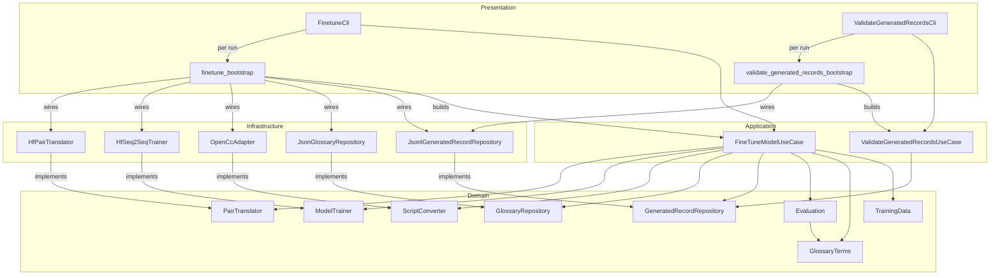
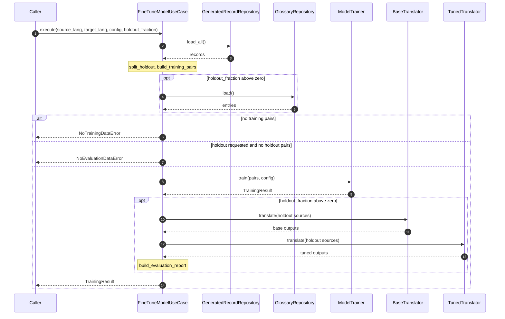
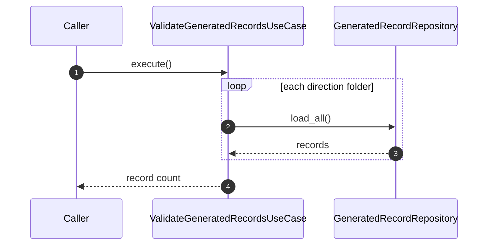
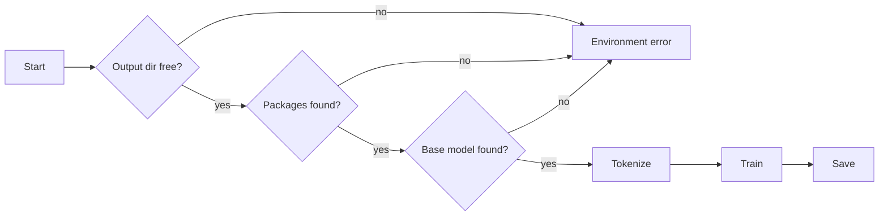

# Sentinel Rosetta Fine-tuning

## 1. Project Description

微調程式用一條指令，以教師大型語言模型（Large Language Model, LLM）產生的資料微調 Helsinki-NLP Opus-MT 的 PyTorch 檢查點。指令依 `-s`、`-t` 讀取 `data/llm_generated/<source>_to_<target>/` 下所有 `*.jsonl`，調整單一翻譯方向的模型權重，並把新的檢查點寫到指定目錄。第二個指令檢查資料檔的欄位格式。

生成資料是 Claude 或 Gemini 依產製規則翻譯、尚未經人工審閱的句對（`ADR-0011`）。評估預設關閉；啟用後，一部分記錄不參與訓練，訓練後以 chrF 與術語命中率比較原始與微調後檢查點對這些句子的翻譯，衡量模型與教師的一致程度（`ADR-0008`、`ADR-0009`、`ADR-0012`）。

不做：轉成 CTranslate2 格式、產製或審閱生成資料、在目標主機訓練。核心設計約束：把記錄轉成訓練契約與評分的字串處理規則只存在於 Domain 的純函式；Command-Line Interface (CLI) 只解析參數，訓練函式庫的 adapter 只做 tokenize 與訓練（`ADR-0007`）。設計決策記錄於 Architecture Decision Record (ADR)，見第 4 節。

**前提：** 微調需要 `torch` 與 `accelerate`，只安裝在訓練機，不進 `pyproject.toml`（`ADR-0006`）。翻譯服務使用的 `models/opus-mt-*` 只含 tokenizer，沒有權重；原始檢查點需一次性下載到 `models/hf/`，指令見 `README.md`。參考詞彙表 `data/llm_reference/glossary_en_to_zh.json`（本機檔案，不隨倉庫發布）是教師與評估共用的單一來源，翻譯服務不讀取（`ADR-0010`）。

**用詞對照：**

| 詞 | 意義 | 對應的名稱 |
| --- | --- | --- |
| 生成資料 | 教師 LLM 產生的 `en`／`zh` 句對的記錄集合，每個產生者一個檔案 | `data/llm_generated/<source>_to_<target>/*.jsonl` |
| 記錄 | 生成資料的一行 | `GeneratedRecord` |
| 方向資料夾 | 一個翻譯方向的生成資料；名稱是教師收到的語言與譯出的語言 | `data/llm_generated/en_to_zh/` |
| 參考詞彙表 | 縮寫、全名與繁體中文譯名的對照，供教師閱讀與評估；檔案只在本機，不隨倉庫發布 | `GlossaryEntry`、`data/llm_reference/glossary_en_to_zh.json` |
| 訓練契約 | 訓練 adapter 接受的輸入：source 與 target 文字的配對 | `TrainingPair` |
| 留出集 | 訓練時不使用、只用於評估的句對，教師譯文是參考答案 | `split_holdout()` |
| 術語命中 | 留出句中，教師譯文遵守詞條，微調後的輸出也含其譯名 | `build_evaluation_report()` |

## 2. Architecture

### 2.1 Component Diagram

- **依賴方向：** Domain 不 import 其他層；Application 只 import Domain；Infrastructure 至多 import Domain；兩個 bootstrap 組裝 Application 與 Infrastructure，並與翻譯服務的 `bootstrap.py` 分開，避免載入 CTranslate2 與離線環境設定。
- **資源所有權：** `load_all()` 與 `load()` 以 `with` 開啟檔案並在返回前關閉，回傳新建的 tuple，由呼叫端擁有。`train()` 與 `HfPairTranslator.translate()` 載入的模型與 tokenizer 是區域變數，隨呼叫返回釋放。基礎檢查點目錄唯讀；輸出目錄由 `train()` 建立，寫入完成後歸使用者，程式不再刪除。沒有跨 thread 或 process 的交接。

### 2.2 Types and Interfaces

```mermaid
classDiagram
    direction TB

    class FinetuneCli {
        <<module>>
        +main(argv) int
    }

    class finetune_bootstrap {
        <<module>>
        +build_finetune_model_use_case(source_lang, target_lang, base_model_dir, output_dir, max_length) FineTuneModelUseCase
    }

    class ValidateGeneratedRecordsCli {
        <<module>>
        +main(argv) int
    }

    class validate_generated_records_bootstrap {
        <<module>>
        +build_validate_generated_records_use_case() ValidateGeneratedRecordsUseCase
    }

    class FineTuneModelUseCase {
        -record_repository: GeneratedRecordRepository
        -glossary_repository: GlossaryRepository
        -script_converter: ScriptConverter
        -model_trainer: ModelTrainer
        -base_translator: PairTranslator
        -tuned_translator: PairTranslator
        +execute(source_lang, target_lang, config, holdout_fraction) TrainingResult
    }

    class ValidateGeneratedRecordsUseCase {
        -record_repositories: tuple
        +execute() int
    }

    class TrainingData {
        <<module>>
        +split_holdout(records, holdout_fraction, seed) tuple
        +build_training_pairs(records, source_lang, target_lang, script_converter) tuple~TrainingPair~
    }

    class GlossaryTerms {
        <<module>>
        +terms_in_text(text, language, entries) tuple~GlossaryEntry~
        +simplify_entries(entries, script_converter) tuple~GlossaryEntry~
    }

    class Evaluation {
        <<module>>
        +chrf_score(hypotheses, references) float
        +build_evaluation_report(holdout_pairs, base_outputs, tuned_outputs, entries, source_lang, target_lang) EvaluationReport
    }

    class GeneratedRecordRepository {
        <<interface>>
        +load_all() tuple~GeneratedRecord~
    }

    class GlossaryRepository {
        <<interface>>
        +load() tuple~GlossaryEntry~
    }

    class ModelTrainer {
        <<interface>>
        +train(pairs, config) TrainingResult
    }

    class PairTranslator {
        <<interface>>
        +translate(source_texts) tuple~str~
    }

    class ScriptConverter {
        <<interface>>
        +to_simplified(text) str
    }

    class JsonlGeneratedRecordRepository {
        -records_dir: Path
        +load_all() tuple~GeneratedRecord~
    }

    class JsonGlossaryRepository {
        -glossary_path: Path
        +load() tuple~GlossaryEntry~
    }

    class OpenCcAdapter {
        -t2s: OpenCC
        -s2twp: OpenCC
        +to_simplified(text) str
        +to_traditional(text) str
    }

    class HfSeq2SeqTrainer {
        -base_model_dir: Path
        -output_dir: Path
        -is_package_installed: Callable
        +train(pairs, config) TrainingResult
    }

    class HfPairTranslator {
        -model_dir: Path
        -max_length: int
        -batch_size: int
        -is_package_installed: Callable
        +translate(source_texts) tuple~str~
    }

    FinetuneCli --> FineTuneModelUseCase : calls
    finetune_bootstrap ..> FineTuneModelUseCase : builds
    ValidateGeneratedRecordsCli --> ValidateGeneratedRecordsUseCase : calls
    validate_generated_records_bootstrap ..> ValidateGeneratedRecordsUseCase : builds
    FineTuneModelUseCase --> TrainingData : calls
    FineTuneModelUseCase --> GlossaryTerms : calls
    FineTuneModelUseCase --> Evaluation : calls
    FineTuneModelUseCase --> GeneratedRecordRepository : calls
    FineTuneModelUseCase --> GlossaryRepository : calls
    FineTuneModelUseCase --> ScriptConverter : passes
    FineTuneModelUseCase --> ModelTrainer : calls
    FineTuneModelUseCase --> PairTranslator : calls
    ValidateGeneratedRecordsUseCase --> GeneratedRecordRepository : calls
    Evaluation --> GlossaryTerms : calls
    JsonlGeneratedRecordRepository ..|> GeneratedRecordRepository : realizes
    JsonGlossaryRepository ..|> GlossaryRepository : realizes
    OpenCcAdapter ..|> ScriptConverter : realizes
    HfSeq2SeqTrainer ..|> ModelTrainer : realizes
    HfPairTranslator ..|> PairTranslator : realizes
```

## 3. Flow of Control

### 3.1 Flow: Fine-tune a Model

1. 圖中步驟 1 至 3：載入 `data/llm_generated/<s>_to_<t>/` 下全部 `*.jsonl`，`<s>`、`<t>` 是 `-s`、`-t` 的值，資料夾由 `finetune_bootstrap` 決定；沒有納入旗標，資料夾內所有來源都進入（`ADR-0011`、`ADR-0013`）。第一個 Note：`split_holdout()` 依 `id` 的 hash 切出留出記錄（`ADR-0009`），`build_training_pairs()` 以注入的 `ScriptConverter` 轉簡體並建構訓練 pair（`ADR-0007`）。
2. 圖中步驟 4 至 5：只在 `holdout_fraction` 大於 0 時載入參考詞彙表並把譯名轉簡體。這一段放在訓練之前，詞彙表缺失或不合規時，在耗時的訓練開始前就失敗。
3. 圖中步驟 6 至 7：兩種「沒有資料」的錯誤都在訓練之前拋出，`train()` 不被呼叫。
4. 圖中步驟 8 至 9：`train()` 回傳 `TrainingResult`。
5. 圖中步驟 10 至 13：`BaseTranslator`（原始檢查點）與 `TunedTranslator`（輸出目錄的檢查點）是同一個 interface 的兩個實例，翻譯留出句。第二個 Note：`build_evaluation_report()` 以 chrF 與術語命中計分（`ADR-0008`、`ADR-0012`）。
6. 圖中步驟 14：回傳 `TrainingResult`，其 `evaluation` 欄位是報告；沒有留出集時為 `None`。

### 3.2 Flow: Validate the Generated Records

1. 圖中步驟 1 至 3：每個方向資料夾一個 `GeneratedRecordRepository`。格式不合規時 `load_all()` 拋出 `GeneratedRecordFormatError`，use case 不捕捉。
2. 圖中步驟 4：回傳各資料夾記錄數的總和。格式檢查就是 `load_all()` 的載入檢查：欄位與格式（`ADR-0001`）、`id` 不重複（`ADR-0005`）、`origin` 等於檔名主檔名（`ADR-0011`）；譯文內容是否正確不在檢查範圍。

### 3.3 Flow: Trainer Preconditions

`HfSeq2SeqTrainer.train()` 在載入任何大型資源前依序檢查前提，任一項失敗就拋出 `TrainingEnvironmentError`：

- `Output dir free?`：輸出目錄不存在，或存在但為空；非空時拒絕，不覆寫既有檔案。
- `Packages found?`：`torch` 與 `accelerate` 都可匯入。
- `Base model found?`：基礎檢查點目錄含 `config.json`，且含 `pytorch_model.bin` 或 `model.safetensors`。
- `Tokenize`、`Train`、`Save`：以該方向模型的 tokenizer 編碼，`Seq2SeqTrainer` 在 CPU 上訓練，不存中間檢查點，`seed` 固定；函式庫印到 stdout 的進度轉到 stderr，stdout 只留 CLI 的摘要行；最後 `save_model` 與 `tokenizer.save_pretrained` 寫入輸出目錄。

`HfPairTranslator.translate()` 先確認檢查點目錄含 `config.json` 與權重檔，缺少時拋出 `TrainingEnvironmentError`；接著以批次大小 8 編碼，以檢查點內的 `generation_config` 做 beam search，最多生成 `max_length` 個 token，依輸入順序每句回傳一個翻譯。

### 3.4 Interface

| 動作 | Operation | 指令或呼叫 | 預期輸出 |
| --- | --- | --- | --- |
| 檢查資料檔的欄位格式 | `ValidateGeneratedRecordsUseCase.execute` | `python -m sentinel_rosetta.presentation.validate_generated_records_cli` | 合規：stdout 一行，內容是檢查的記錄數，exit code 0。不合規：stderr 印出 `GeneratedRecordFormatError` 的訊息（含檔案路徑與行號），exit code 1 |
| 微調 `en→zh`，全部生成資料 | `FineTuneModelUseCase.execute` | `python -m sentinel_rosetta.presentation.finetune_cli -s en -t zh` | stdout 一行，內容是微調的句對數、`train_loss` 與輸出目錄 `models/finetuned/opus-mt-en-zh`，exit code 0 |
| 微調 `zh→en` | `FineTuneModelUseCase.execute` | `python -m sentinel_rosetta.presentation.finetune_cli -s zh -t en` | `zh_to_en/` 有記錄時同上，輸出目錄為 `models/finetuned/opus-mt-zh-en`；沒有該資料夾時 stderr 印出 `NoTrainingDataError` 的訊息，exit code 1 |
| 微調 `en→zh`，留出 25% 作評估 | `FineTuneModelUseCase.execute` | `python -m sentinel_rosetta.presentation.finetune_cli -s en -t zh --holdout-fraction 0.25 --output-dir models/finetuned/opus-mt-en-zh-holdout` | stdout 三行：微調摘要；留出句數與原始、微調後檢查點的 chrF；術語命中數 / 預期數（原始、微調後）；stderr 逐句列出參考答案、原始與微調後檢查點的翻譯 |
| 把微調後的檢查點接入翻譯服務 | — | `README.md` 的「Using a fine-tuned checkpoint in the translation service」：先轉換到 `models/opus-mt-en-zh-ct2.staging/`，成功後再替換 `models/opus-mt-en-zh-ct2/` | 重新啟動 API 伺服器或重新執行 `sentinel translate` 後，翻譯使用新權重 |

- **入口與共享狀態：** 以 `python -m` 執行，不新增 `pyproject.toml` 的 console script。生成資料在 `data/llm_generated/`，參考詞彙表在 `data/llm_reference/`（唯讀，不隨倉庫發布），基礎檢查點在 `models/hf/`（唯讀），輸出在 `models/finetuned/`。
- **無法 headless 驗證的行為：** 實際耗時與記憶體用量；評估分數與命中數的高低取決於資料，Environment tier 只驗證流程跑完與輸出格式。

## 4. Decisions

決策記錄在 [`docs/DecisionRecord.md`](DecisionRecord.md)。本文件相關的決策：`ADR-0001`、`ADR-0002`、`ADR-0005`、`ADR-0006`、`ADR-0007`、`ADR-0008`、`ADR-0009`、`ADR-0010`、`ADR-0011`、`ADR-0012`、`ADR-0013`。

## 5. Testing

測試計畫寫在 [`docs/TestDocument_Finetune.md`](TestDocument_Finetune.md)，本節只說明驗證方式。

### 5.1 Verification Approach

- **純邏輯：** Domain 的詞條比對、切分、契約建構與評分以輸入輸出直接驗證，轉簡體以 fake `ScriptConverter` 隔離；chrF 的數值以 `sacrebleu` 的結果作為參考值。
- **流程：** 兩個 use case 以 fake repository、fake `PairTranslator` 與 spy `ModelTrainer` 驗證載入、呼叫順序、報告內容與錯誤路徑，不需要 `torch`。
- **檔案與資料：** 兩個 repository 以 `tmp_path` 驗證契約；真實生成資料以整合測試驗證格式與 `id` 唯一；詞彙表的格式只以 `tmp_path` 內的檔案驗證，倉庫沒有真實詞彙表。
- **環境：** `HfSeq2SeqTrainer` 與 `HfPairTranslator` 以真實檢查點與 `torch` 跑完一次極小的訓練與翻譯；帶 `--holdout-fraction` 的 CLI 以真實檢查點驗證輸出格式。
